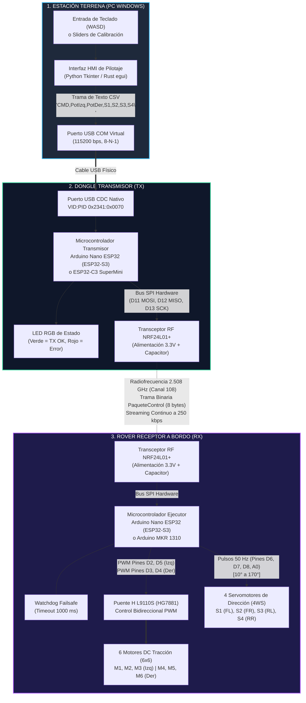
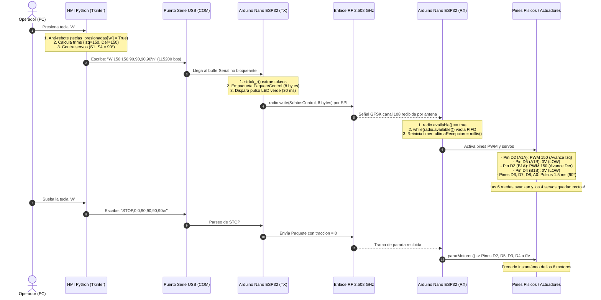
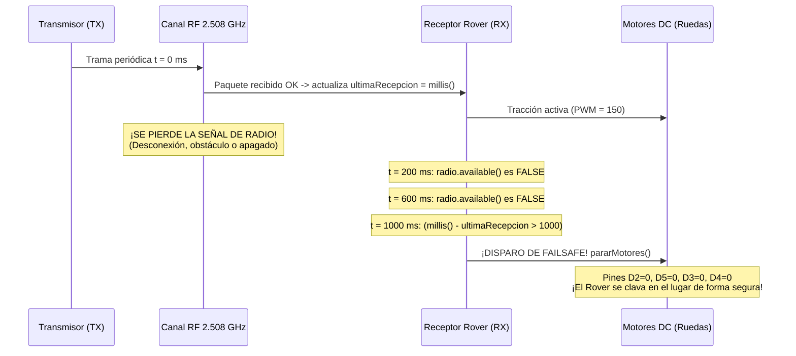
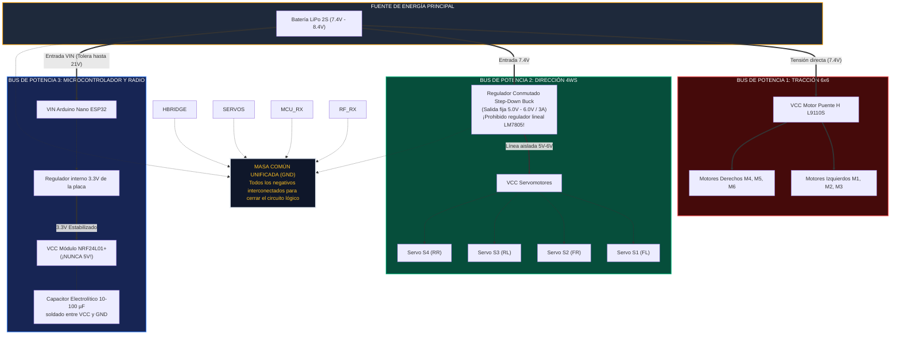

# AYUDAS VISUALES, DIAGRAMAS Y ARQUITECTURA: ROVER LUNAR CEPIT V2.0
## Material Gráfico de Presentación, Diagramas de Flujo y Esquemas de Hardware

> **Documento de Apoyo Visual para Demostraciones, Defensas Técnicas y Exposición**  
> **Proyecto:** Rover Lunar CEPIT V2.0 — Plataforma Rocker-Bogie 6x6 + 4WS  
> **Equipo CEPIT:** Joaquin, Lucas, Lucio, Sebastian, Emir, Benjamin, Keila y Ainsworth.

---

## 1. Diagrama de Arquitectura Global del Sistema (3 Nodos)



---

## 2. Diagrama de Secuencia End-to-End: Presionar la Tecla 'W'

Este diagrama ilustra cronológicamente cada milisegundo desde que el dedo del usuario presiona la tecla **W** hasta el giro físico de las 6 ruedas:



---

## 3. Diagrama de Secuencia: Watchdog Failsafe por Pérdida de Señal

Muestra qué sucede si se corta la comunicación por radio (interferencia, distancia o apagado del emisor):



---

## 4. Mapa Visual del Pinout Físico: Arduino Nano ESP32

Diagrama esquemático en arte ASCII de la placa oficial **Arduino Nano ESP32** (ESP32-S3 a 3.3V) a bordo del Rover:

```text
                               ARDUINO NANO ESP32
                                  +-----------+
                                  |   [USB]   |
               (RF24 SCK)  D13 [  ] |           | [  ] D12  (RF24 MISO)
             (RF24 VCC)   3.3V [  ] |           | [  ] D11  (RF24 MOSI)
              (DISPONIBLE) AREF [  ] |           | [  ] D10  (RF24 CSN)
              (Servo 4 S4)   A0 [  ] |           | [  ] D9   (RF24 CE)
       *LIBRE* (Sensor ADC)  A1 [  ] |           | [  ] D8   (Servo 3 S3)
       *LIBRE* (Sensor ADC)  A2 [  ] |           | [  ] D7   (Servo 2 S2)
       *LIBRE* (Sensor ADC)  A3 [  ] |           | [  ] D6   (Servo 1 S1)
        *LIBRE* (I2C SDA)   A4 [  ] |           | [  ] D5   (L9110S A1B - Izq Rev)
        *LIBRE* (I2C SCL)   A5 [  ] |           | [  ] D4   (L9110S B1B - Der Rev)
             *LIBRE* (ADC)  A6 [  ] |           | [  ] D3   (L9110S B1A - Der Av)
             *LIBRE* (ADC)  A7 [  ] |           | [  ] D2   (L9110S A1A - Izq Av)
                 (5V USB)  VBUS [  ] |           | [  ] GND  ------> MASA COMÚN
                               RST [  ] |           | [  ] RST
                 MASA COMÚN   GND [  ] |           | [  ] D0   (RX0 / *LIBRE UART*)
    (Entrada 6V-21V Batería)  VIN [  ] |           | [  ] D1   (TX0 / *LIBRE UART*)
                                  +-----------+
```

### Código de Colores Funcional:
* **Líneas de Radio NRF24L01+ (Bus SPI):** Pines `D9`, `D10`, `D11`, `D12`, `D13` y `3.3V`.
* **Líneas del Puente H L9110S (Motores):** Pines `D2`, `D3`, `D4`, `D5`.
* **Líneas de los Servomotores (Dirección):** Pines `D6` (S1), `D7` (S2), `D8` (S3), `A0` (S4).
* **Pines Libres para Sensores de Misión:**
  * `A4` y `A5`: Giroscopio / IMU por I2C (crucial para rampa de 20°).
  * `A1`: Medición de voltaje de batería (divisor resistivo).
  * `D0` y `D1`: Puerto serie para módulo de visión ESP32-CAM.

---

## 5. Esquema de Alimentación y Buses de Potencia Aislados



---

## 6. Cinemática del Chasis Rocker-Bogie: Modos de Conducción

A continuación se muestra cómo se orientan físicamente las ruedas en los distintos modos de operación:

```text
===================================================================================
1. AVANCE RECTO (TECLA W)
   Todos los servos a 90° (neutro). Motores giran en sentido positivo.
   
        [S1: 90°] | M1 |                | M4 | [S2: 90°]
                         \            /
                  | M2 |  ====[CHASIS]====  | M5 |   (Ruedas centrales fijas)
                         /            \
        [S3: 90°] | M3 |                | M6 | [S4: 90°]
        
===================================================================================
2. CURVA ACKERMANN A LA IZQUIERDA (TECLA A)
   Delanteras a 120° (abiertas hacia afuera), Traseras a 60° (coordinadas).
   
        [S1: 120°] \ M1 \               \ M4 \ [S2: 120°]
                          \           /
                   | M2 |  ===[CHASIS]===  | M5 |
                          /           \
        [S3: 60°]  / M3 /               / M6 / [S4: 60°]
        
===================================================================================
3. GIRO EN EL LUGAR / POINT TURN 360° (TECLAS Q / E)
   Las 4 esquinas se orientan a 45° tangenciales a la circunferencia del chasis.
   Motores izquierdos giran en reversa (-150) y derechos en avance (+150).
   
        [S1: 45°]  / M1 /               \ M4 \ [S2: 135°]
                          \           /
                   | M2 |  ===[CHASIS]===  | M5 |
                          /           \
        [S3: 135°] \ M3 \               / M6 / [S4: 45°]
        
===================================================================================
4. MODO CANGREJO / CRAB DRIVE (AVANCE DIAGONAL LATERAL)
   Las 4 ruedas giran exactamente en el mismo ángulo paralelo. El chasis no rota.
   
        [S1: 135°] \ M1 \               \ M4 \ [S2: 135°]
                          \           /
                   | M2 |  ===[CHASIS]===  | M5 |
                          /           \
        [S3: 135°] \ M3 \               \ M6 \ [S4: 135°]
===================================================================================
```

---

## 7. Ficha Técnica Comparativa: Canales de Comunicación

| Parámetro | Cable USB Serie (PC $\rightarrow$ TX) | Radio NRF24L01+ (TX $\rightarrow$ RX) | Wi-Fi SoftAP (Cámara ESP32-CAM) |
|---|---|---|---|
| **Medio Físico** | Cable de cobre USB | Ondas electromagnéticas RF | Ondas electromagnéticas Wi-Fi |
| **Frecuencia / Canal** | Banda base USB | **Canal 108 (2.508 GHz)** | Canal 1 o 6 (2.412 - 2.437 GHz) |
| **Formato de Datos** | Texto ASCII CSV | **Binario empaquetado (8 bytes)** | HTTP / Streams MJPEG / TCP |
| **Tasa de Datos** | 115200 bps | 250 kbps | Hasta 54 Mbps (802.11g) |
| **Latencia Típica** | $< 1\,\text{ms}$ | **$< 2\,\text{ms}$** | $80\,\text{ms} - 250\,\text{ms}$ |
| **Sensibilidad a Interferencias** | Nula (apantallado) | **Inmune** (opera fuera de Wi-Fi) | Alta (comparte banda comercial) |
| **Función en el Rover** | Consola y pilotaje desde PC | **Tracción y dirección crítica** | **Video y telemetría de imagen** |

---

## 8. Tarjetas Resumen de Respuesta Rápida (Cheat-Sheet para Exposición)

```
┌─────────────────────────────────────────────────────────────────────────────────┐
│ TEMA: ¿CÓMO VIAJA LA INFORMACIÓN?                                                │
│ 1. Usuario aprieta W en la PC.                                                  │
│ 2. HMI Python envía por cable USB: "W,150,150,90,90,90,90\n" a 115200 bps.     │
│ 3. Arduino transmisor extrae datos y arma un paquete binario de 8 bytes.        │
│ 4. Radio NRF24L01 transmite en 2.508 GHz (Canal 108) a 250 kbps.                │
│ 5. Arduino receptor a bordo recibe la trama y vacía la cola FIFO.               │
│ 6. Aplica PWM a Pines D2 y D3 (Puente H L9110S) y pulsos a Pines D6..A0 (Servos)│
│ 7. Ruedas avanzan. Si se corta la señal por 1 segundo, el Rover frena solo.     │
└─────────────────────────────────────────────────────────────────────────────────┘

┌─────────────────────────────────────────────────────────────────────────────────┐
│ TEMA: ¿POR QUÉ NO SE USA WI-FI PARA EL MOVIMIENTO?                              │
│ - El Wi-Fi tiene latencia variable (jitter) y si hay congestión genera retardo. │
│ - Si se pierde un paquete TCP, el sistema se congela esperando retransmisión.   │
│ - NRF24L01 en Canal 108 (2.508 GHz) está FUERA de las frecuencias Wi-Fi comunes.│
│ - El Wi-Fi SÍ se usa, pero exclusivamente para la cámara ESP32-CAM en modo      │
│   SoftAP (Access Point en IP 192.168.4.1 con socket de video en puerto 81).     │
└─────────────────────────────────────────────────────────────────────────────────┘

┌─────────────────────────────────────────────────────────────────────────────────┐
│ TEMA: REGLAS DE ORO DE HARDWARE (LECCIONES APRENDIDAS EN CEPIT)                 │
│ 1. NRF24L01 NUNCA a 5V: siempre a 3.3V con capacitor de 10-100 µF soldado.       │
│ 2. Servos alimentados con Step-Down conmutado (5V-6V). Prohibido LM7805.        │
│ 3. Límites por software en servos: constrain entre 10° y 170° para no romper piñón│
│ 4. Toda la lógica de control es no bloqueante (cero delays, todo con millis()). │
└─────────────────────────────────────────────────────────────────────────────────┘
```
