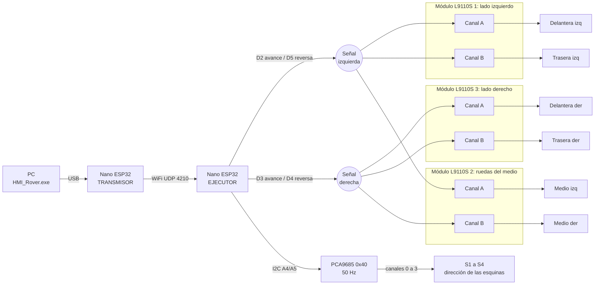
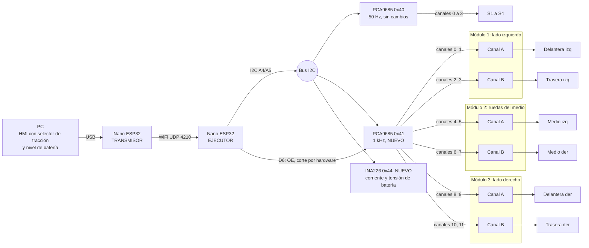

# Propuesta: tracción escalonada para gastar menos batería

Estado: **propuesta, no implementada.** El sistema activo sigue siendo el de `01_Oficial/` y su esquemático vigente, `03_Documentacion_y_Guias/Esquematicos/ESQUEMATICO_NANO_ESP32.md`.

**Objetivo:** que la batería dure más. En llano o en pendientes suaves, solo las 2 ruedas delanteras traccionan. Las otras 4 giran arrastradas, sin consumir. Si hace falta más fuerza se suman las del medio, y después las de atrás.

---

## 1. Arquitectura actual (v3.1)

### Diagrama



### Conexiones

| Señal del Nano | Llega a | Ruedas |
|---|---|---|
| D2 (izquierda avance), D5 (izquierda reversa) | Módulo 1 canales A y B, módulo 2 canal A | Las 3 izquierdas |
| D3 (derecha avance), D4 (derecha reversa) | Módulo 3 canales A y B, módulo 2 canal B | Las 3 derechas |
| A4 / A5 | PCA9685 0x40 SDA / SCL | Servos S1 a S4 por los canales 0 a 3 |

> Supuesto: en los módulos 1 y 3 el canal A es la rueda delantera y el B la trasera. En el módulo 2, el A es la izquierda y el B la derecha. **Confirmar con la PCB.**

### Limitación para esta idea

El firmware solo maneja **dos lados**, el izquierdo y el derecho. Las 3 ruedas de un lado reciben siempre la misma orden, así que no se puede prender solo la delantera.

---

## 2. Las ruedas que no traccionan: rueda libre, no freno

Una rueda arrastrada hace girar su motor, y el motor genera tensión. Lo que pase con esa tensión depende de cómo queden los bornes:

| Estado de los bornes del motor | Qué pasa | Efecto en la batería |
|---|---|---|
| **Abiertos (rueda libre)** | Genera tensión pero no circula corriente | **Lo mejor.** No consume, y lo único que frena es la fricción de la caja de reducción |
| Unidos entre sí (freno) | La tensión generada hace circular corriente por el propio motor y lo frena | **Lo peor.** Las ruedas delanteras gastan de más para arrastrar ruedas que frenan |
| Con PWM bajo (arrastre compensado) | El motor recibe lo justo para cancelar la fricción de su caja | Consume poco. Puede convenir si la caja frena mucho en rueda libre |

Para gastar lo mínimo, **las ruedas que no traccionan tienen que quedar en rueda libre.** Generar algo de energía no sirve: para eso la rueda tiene que frenar, y esa energía la terminan poniendo las ruedas delanteras, con pérdidas.

### El L9110S no tiene rueda libre (confirmado)

El equipo comprobó en el rover que, sin PWM, las ruedas quedan frenadas. Coincide con la hoja de datos del L9110: con las dos entradas en bajo, las dos salidas quedan en bajo y **los bornes del motor quedan unidos.** Con los módulos actuales, una rueda que no tracciona frena a las demás.

Hay tres formas de conseguir rueda libre:

| Opción | Cómo | A favor | En contra |
|---|---|---|---|
| **Cambiar los módulos por DRV8833 (recomendada)** | Mismo esquema de 2 entradas por motor. Con las dos en bajo, rueda libre | Sin piezas extra ni consumo extra. Aguanta 1,5 A por canal contra 0,8 A del L9110S. Cuesta parecido | Hay que cambiar los módulos o rehacer la PCB |
| Relé en serie con cada motor que no tracciona | El relé abre el circuito del motor cuando no recibe PWM | Se puede probar sobre la PCB actual | 4 relés, más sus drivers y cables. Cada bobina consume 70 a 90 mA mientras está cerrada. Hay que conmutar sin corriente para no quemar los contactos |
| Arrastre compensado con PWM bajo | Darle al motor lo justo para cancelar la fricción de su caja | Sin hardware nuevo | En la parte apagada del ciclo el L9110S frena igual. Se pierde gran parte del beneficio |

### Si se prueba con relés

Para que los relés no se coman el ahorro:

- **Solo en las 4 ruedas que pueden quedar libres** (medio y traseras). Las delanteras siempre traccionan.
- **Contacto normalmente abierto:** sin energía en la bobina, el motor queda desconectado (rueda libre). La bobina consume solo cuando esa rueda tracciona, en los niveles 2 y 3. En el nivel 1, que es el de ahorro, los relés no consumen nada.
- **Mando desde los canales libres 12 a 15 del PCA9685 nuevo**, con un módulo de 4 relés con optoacoplador que acepte entradas de 3,3 V. Muchos módulos comunes necesitan 5 V en la entrada: verificar antes de comprar.
- **Secuencia en el firmware:** para soltar una rueda, primero PWM a cero, esperar 20 ms y recién ahí abrir el relé. Para sumarla, cerrar el relé, esperar 20 ms y recién ahí arrancar la rampa de PWM. Así el contacto nunca abre ni cierra con corriente.
- **Comparación:** 4 relés con sus bobinas (unos 0,3 A en los niveles 2 y 3) contra 3 módulos DRV8833 sin consumo extra. Los relés sirven para validar la idea rápido. Para la versión final conviene el DRV8833.

### ¿Se puede recuperar energía con la rueda libre?

**No.** Con el circuito abierto el motor genera tensión pero no circula corriente, así que no entra nada a la batería. Para recuperar hay que conectarle una carga, y en ese momento la rueda frena. La energía que recupera la pusieron las ruedas delanteras, y se pierde en cada paso del camino: motor delantero, rueda, suelo, rueda trasera, caja de reducción, motor como generador, circuito de carga.

| Situación | ¿Hay energía para recuperar? |
|---|---|
| Llano o subida | **No.** Cada joule recuperado le cuesta más de un joule a las ruedas delanteras |
| Bajada o frenado | Sí, pero es muy poca. Un rover de 3 kg que baja 1 m tiene unos 30 J. La batería propuesta guarda unos 160.000 J |
| Además | La caja 1:48 de plástico pierde buena parte al girar al revés, y a la velocidad del rover el motor genera menos tensión que la batería: haría falta un elevador de tensión |

Para que la batería dure, lo que funciona es **no gastar**: rueda libre en las ruedas que no traccionan, PWM limitado a la tensión de los motores, y menos ruedas activas en llano.

---

## 3. Arquitectura propuesta

### Diagrama



Cada rueda queda con su propio par de señales: el firmware puede poner cualquiera en tracción, rueda libre o arrastre compensado.

### Por qué un segundo PCA9685

| Opción | Costo | Problema |
|---|---|---|
| **Segundo PCA9685 en 0x41 (recomendada)** | 1 módulo, unos USD 5 | Ninguno serio. Tiene 16 canales a ~1 kHz y deja libres los pines del Nano |
| Canales 4 a 15 del PCA9685 actual | Nada | Esa placa trabaja a 50 Hz por los servos. Con motores eso da marcha a los tirones a baja potencia |
| Pines directos del Nano (6 PWM + 6 de dirección) | Nada | Ocupa casi todos los pines y no quedan para los encoders de la hoja de ruta |

### Conexiones nuevas

**Segundo PCA9685 (0x41):** se configura soldando el puente A0 de la placa.

| Canales PCA9685 0x41 | Entradas | Rueda |
|---|---|---|
| 0 / 1 | Módulo 1, A-1A / A-1B | Delantera izquierda |
| 2 / 3 | Módulo 1, B-1A / B-1B | Trasera izquierda |
| 4 / 5 | Módulo 2, A-1A / A-1B | Medio izquierda |
| 6 / 7 | Módulo 2, B-1A / B-1B | Medio derecha |
| 8 / 9 | Módulo 3, A-1A / A-1B | Delantera derecha |
| 10 / 11 | Módulo 3, B-1A / B-1B | Trasera derecha |
| 12 a 15 | Libres | Reserva |

| Pin del PCA9685 0x41 | Conexión |
|---|---|
| VCC | 3.3V del Nano. Así las señales salen a 3,3 V, como ahora |
| GND | Masa común en estrella |
| SDA / SCL | En paralelo con el PCA9685 actual, a A4 / A5 |
| OE | Nano D6, más una resistencia de 10 kΩ a 3.3V |
| V+ | **Sin conectar.** Esta placa no alimenta servos |

**Corte por hardware (OE):** con la resistencia a 3.3V, las salidas quedan **apagadas** desde que se enciende el rover hasta que el firmware pone D6 en bajo. Si el ejecutor se reinicia o se cuelga, los motores se cortan solos. Hoy esa protección no existe.

**INA226 (0x44):** con un shunt de 10 mΩ, en serie entre la batería y el riel de motores. Mide hasta unos 8 A de corriente y también la **tensión de la batería**. Un INA219 común no sirve: con su shunt de 0,1 Ω llega solo a 3,2 A y su dirección por defecto (0x40) choca con la del PCA9685.

**Pines del Nano:** D2 a D5 quedan libres. Se reservan para los encoders.

### ¿Cablear sobre la PCB actual o rehacerla?

El cambio es chico. Para probar alcanza con cablear sobre la PCB actual:

1. Cortar las 4 pistas que llevan D2, D3, D4 y D5 a los módulos. Las uniones en paralelo entre módulos también hay que separarlas: cada entrada tiene que quedar sola.
2. Llevar 12 cables del PCA9685 nuevo a las 12 entradas de los módulos.
3. Sumar el INA226 en el cable de batería a motores, y la línea OE.

Cuando el equipo apruebe la idea, Lucas lo integra en la PCB nueva, idealmente con DRV8833 en lugar de L9110S (sección 2).

### Lógica del ejecutor

```text
NIVEL 1  delanteras a la consigna; medio y traseras en rueda libre
NIVEL 2  delanteras y medio a la consigna; traseras en rueda libre
NIVEL 3  las 6 a la consigna (como hoy)

Subir un nivel:  corriente de las ruedas activas > umbral durante 300 ms
                 (o, con encoders, la velocidad cae con la misma consigna)
Bajar un nivel:  corriente < umbral bajo durante 2 s (histéresis, para que no oscile)

Siempre nivel 3: pivote (las 6 ruedas tienen que empujar), o si la HMI lo fija
Orden de ejes:   configurable. En subida el peso se carga atrás y las delanteras agarran menos
```

Las protecciones actuales siguen igual, ahora por rueda: rampa de PWM, inversión pasando por cero, arranques desfasados, failsafe y arranque por etapas.

**Riesgo:** en nivel 1, dos motores mueven todo el rover. Cada canal del L9110S admite unos 0,8 A continuos, y un motor TT bloqueado pasa 1 A. El umbral para pasar al nivel 2 tiene que quedar por debajo de ese límite. Con DRV8833 hay más margen.

### Cambios de protocolo (pasaría a v4.0)

| Mensaje | Cambio |
|---|---|
| `PaqueteControl` | Modo de tracción en `flags`: automático, o fijo en 2, 4 o 6 ruedas |
| `PaqueteTelemetria` | Nivel activo, corriente de motores en mA y tensión de batería |
| HMI | Selector de tracción, indicador de nivel y corriente, y aviso de batería baja |

---

## 4. Batería

Todavía no está comprada. Lo que se elija tiene que respetar estos límites:

| Componente | Rango de tensión |
|---|---|
| Motores TT (motor gris, caja amarilla, 1:48) | 3 a 6 V nominal |
| L9110S | 2,5 a 12 V |
| DRV8833 (si se cambia) | 2,7 a 10,8 V |
| Nano ESP32, pin VIN | 6 a 21 V |
| Servos | 5 a 6 V, por regulador conmutado (buck o UBEC) |

**Recomendación: pack 2S2P de celdas 18650 con BMS.** Son 7,4 V nominales (8,4 V cargado, unos 6,4 V vacío), unos 6 Ah y unos 44 Wh.

- Entra en el rango de todos los componentes. Una 3S (12,6 V cargada) pasa el máximo del L9110S y del DRV8833.
- Las 18650 con BMS son más seguras de manejar que una LiPo suelta.
- **Los motores son de 6 V:** con la batería cargada, el firmware tiene que limitar el PWM máximo a cerca del 70 % (6 V / 8,4 V). Si no, se calientan y se gastan antes.
- **El Nano necesita 6 V en VIN:** con la batería casi vacía queda justo. El INA226 permite que la HMI avise y que el ejecutor pare los motores por debajo de unos 6,8 V. Eso protege las celdas y evita reinicios por batería baja.

**Duración orientativa** con las 6 ruedas, a confirmar midiendo con el INA226: unos 2 A en motores en llano, más servos y placas, da 2,5 a 3,5 horas. Cuánto agrega la tracción escalonada se sabe recién en el paso 3 del plan.

### Alimentación actual del Nano ejecutor: revisar ya

Hoy el Nano ejecutor se alimenta por **VIN** con una pila aparte de unos **4 V**. VIN pide **6 a 21 V**: con 4 V el regulador de la placa trabaja al límite, sin margen.

- **Por qué anda igual:** con poco consumo, el regulador todavía saca sus 3,3 V. Pero no hay garantía.
- **Cuándo falla:** en los picos del WiFi (varios cientos de mA) la pila cae, la placa baja de 3,3 V y se reinicia por **brownout**, el problema que se está investigando. A medida que la pila se descarga, eso se vuelve más frecuente.
- **La masa** de esa pila tiene que estar unida a la de motores y servos. Si no, las señales a los módulos y al PCA9685 no tienen referencia.

**Lo correcto:** 6 V o más en VIN. Mientras no esté el pack 2S, sirven 2 celdas de litio en serie (7,4 V) o 4 a 6 pilas AA en serie (6 a 9 V). Con el pack 2S, el aviso de batería baja del INA226 cuida también que VIN no caiga de 6 V.

---

## 5. Plan sugerido

| Paso | Qué | Para qué |
|---|---|---|
| 1 | Alimentar el Nano ejecutor con 6 V o más en VIN (sección 4) | Sacar una causa posible de reinicios antes de medir nada |
| 2 | Sumar el INA226 sin tocar nada más | Medir el consumo real de hoy con las 6 ruedas, en llano y en rampa |
| 3 | Sumar el segundo PCA9685 y los relés (o DRV8833), cablear sobre la PCB y poner un selector **manual** de 2, 4 o 6 ruedas | Comparar el consumo con las mediciones del paso 2 |
| 4 | Modo automático | Solo si el paso 3 muestra ahorro |
| 5 | PCB nueva con DRV8833 | Rueda libre garantizada y más corriente por canal |

## 6. Datos que faltan

1. Confirmar qué canal de cada módulo va a cada rueda (supuesto de la sección 1).
2. Si la masa de la pila del Nano ejecutor está unida a la de motores y servos.
3. Decidir entre relés para probar sobre la PCB actual o pasar directo a DRV8833.
4. Batería elegida.
