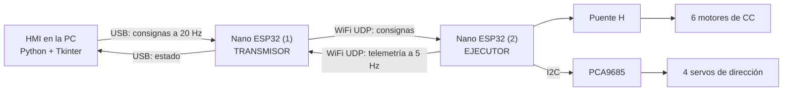
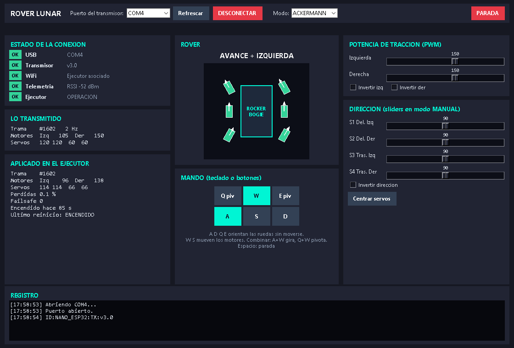
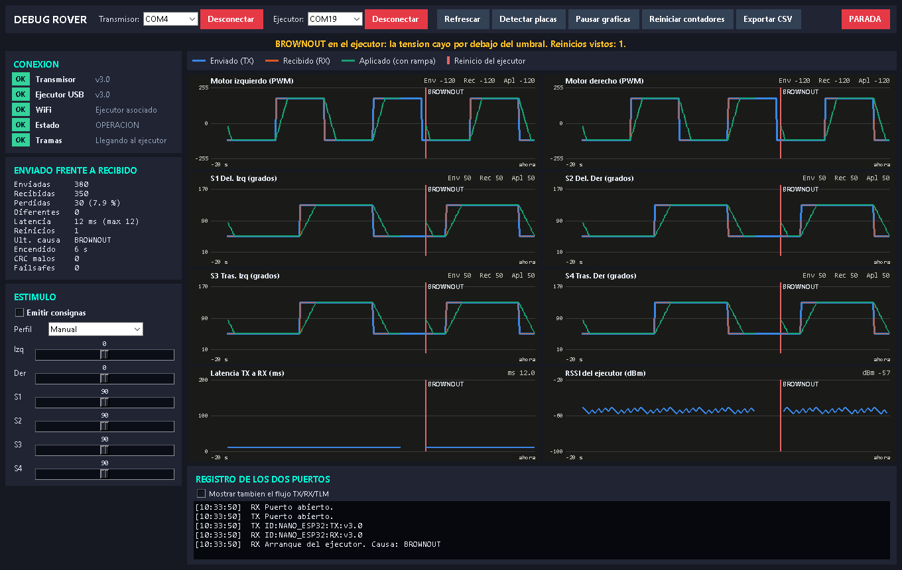
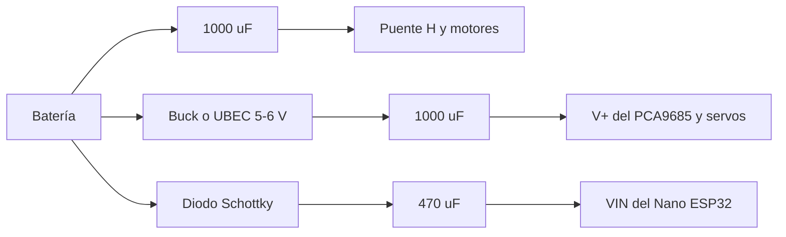

<div align="center">

# Rover Lunar

**Rover de exploración Rocker-Bogie 6x6 con dirección en las 4 esquinas, manejado desde una PC por WiFi**


[Descargar](#descargar-sin-instalar-nada) ·
[Estado actual](#estado-actual) ·
[Cómo funciona](#cómo-funciona) ·
[Conexión](#cómo-se-hace-la-conexión) ·
[Interfaz gráfica](#interfaz-gráfica) ·
[Puesta en marcha](#puesta-en-marcha) ·
[Alimentación](#alimentación-y-reinicios)

*Equipo CEPIT: Joaquín, Lucas, Lucio, Sebastián, Emir, Benjamín, Keila y Ainsworth*

</div>

---

## Descargar sin instalar nada

En la [última release](https://github.com/Glaciojtp/HMI-Lunar-Rover/releases/latest) están los programas listos para Windows. No hace falta instalar Python ni ninguna biblioteca.

| Archivo | Para qué |
|---|---|
| [`HMI_Rover.exe`](https://github.com/Glaciojtp/HMI-Lunar-Rover/releases/latest/download/HMI_Rover.exe) | Manejar el rover. Es lo único que hace falta si las placas ya están cargadas |
| [`HMI_Rover_Debug.exe`](https://github.com/Glaciojtp/HMI-Lunar-Rover/releases/latest/download/HMI_Rover_Debug.exe) | Banco de pruebas con las dos placas conectadas a la PC |
| `Transmisor_NanoESP32.bin`, `Ejecutor_NanoESP32.bin` | Firmwares compilados, para recargar las placas sin compilar |

1. Descargar `HMI_Rover.exe` y abrirlo. Windows puede avisar que es un programa no firmado: **Más información** y después **Ejecutar de todas formas**.
2. Encender el rover y conectar el transmisor por USB.
3. Elegir el puerto, tocar **CONECTAR** y manejar con el teclado ([controles](#hmi-normal)).

---

## Estado actual

*Actualizado: 6 de noviembre de 2026.*

La **v3.0** reorganizó el proyecto y atacó los reinicios del ejecutor por software. **Ya se probó en el rover y funciona**, con puente H **L9110S**. La **v3.1** separa dirección y tracción en el mando: las teclas de dirección solo orientan las ruedas y solo `W` y `S` mueven los motores.

> [!IMPORTANT]
> El firmware reduce los picos de corriente e informa la causa de cada reinicio. Si el ejecutor vuelve a reiniciarse, la HMI lo avisa y la HMI debug muestra la causa. La alimentación se sigue revisando.

### Qué está listo y qué falta

| Parte | Estado | Detalle |
|---|---|---|
| Organización del repositorio | **Listo** | Un solo archivo activo por pieza. Lo anterior está archivado |
| Lógica de los firmwares | **Probada en PC** | Se ejecutan los `.ino` reales con hardware simulado |
| HMI normal y HMI debug | **Funcionan** | Usadas con las placas reales |
| Compilación para ESP32 | **Lista** | Los dos firmwares compilan en el CI con el paquete Arduino ESP32 Boards |
| Prueba en el rover | **Funciona** | Probado por el equipo con L9110S. El mando de la v3.1 falta probarlo en el rover |
| Alimentación | **En revisión** | Ver [Alimentación y reinicios](#alimentación-y-reinicios) |

### Próximos pasos

1. Probar en el rover el mando nuevo de la v3.1, sobre todo el pivote (`Q` o `E` más `W`).
2. Ensayos en rampa a 20 grados (CEPIT) y en terreno natural (Sierra).
3. Si aparecen reinicios, hacer el [diagnóstico](03_Documentacion_y_Guias/Esquematicos/ESQUEMATICO_NANO_ESP32.md#diagnostico-de-reinicios-con-la-hmi-debug) con la HMI debug.

---

## Cómo funciona



| Etapa | Qué hace | Si algo falla |
|---|---|---|
| **HMI** | Convierte teclado o botones en una consigna (potencia por lado y ángulo por servo) y la envía 20 veces por segundo | Si la ventana pierde el foco, suelta las teclas y el rover se detiene |
| **Transmisor** | Recibe la consigna por USB y la retransmite por WiFi | Si la HMI deja de enviar durante **500 ms**, ordena parada |
| **Ejecutor** | Aplica la consigna a motores y servos de forma gradual | Si no llegan tramas durante **1 s**, para los motores y centra los servos |
| **Telemetría** | Informa lo aplicado, la señal WiFi y la causa del último reinicio | Si deja de llegar, la HMI lo marca como falla |

---

## Cómo se hace la conexión

No hace falta router ni internet: el **transmisor crea su propia red** y el **ejecutor se conecta solo** al encenderse.

| Dato | Transmisor | Ejecutor |
|---|---|---|
| Rol WiFi | Access Point | Estación |
| Red / clave | `ROVER_NET` / `rover1234` | La misma |
| Canal | 6 | 6 |
| IP | `192.168.4.1` | `192.168.4.2` (fija) |
| Alimentación | USB de la PC | Batería del rover |

La red la crea el transmisor porque se alimenta del USB: así el ejecutor no carga con esa emisión permanente sobre la batería que comparte con los motores.

| Tramo | Medio | Formato |
|---|---|---|
| HMI a transmisor | USB serie, 115200 bps | Texto: `CMD,izq,der,s1,s2,s3,s4` |
| Transmisor a ejecutor | WiFi UDP, puerto 4210 | Binario de 13 bytes, con secuencia y CRC-8 |
| Ejecutor a transmisor | WiFi UDP, puerto 4210 | Binario de 34 bytes, con CRC-8 |

<details>
<summary><strong>Ver los mensajes que las placas envían a la PC</strong></summary>

| Mensaje | Origen | Contenido |
|---|---|---|
| `ID:NANO_ESP32:TX:v3.0` | Ambas (`TX` o `RX`) | Respuesta al pedido `IDENT` |
| `TX,seq,izq,der,s1,s2,s3,s4,ok` | Transmisor | Cada trama emitida |
| `LINK,clientes,hmi,edad_tlm_ms` | Transmisor | Estado del enlace, 1 vez por segundo |
| `RX,seq,izq,der,s1,s2,s3,s4,dt_ms,aIzq,aDer,a1,a2,a3,a4` | Ejecutor | Cada trama recibida y lo aplicado |
| `TLM,seq,aIzq,aDer,a1,a2,a3,a4,rssi,causa,reinicios,uptime,rxOk,perdidos,crc,failsafes,estado,diag` | Ambas | Telemetría del ejecutor |
| `BOOT,causa,reinicios` | Ejecutor | Causa del arranque |

</details>

---

## Interfaz gráfica

Las HMI están hechas en **Python** y usan solo dos bibliotecas:

| Biblioteca | Para qué se usa | Instalación |
|---|---|---|
| **Tkinter** (con `ttk`) | Ventanas, controles y gráficas dibujadas sobre `Canvas` | Incluida en Python |
| **pyserial** | Comunicación USB con las placas | `pip install pyserial` (los lanzadores la instalan solos) |

La lectura y el envío por USB corren en hilos propios: mover la ventana no interrumpe el flujo de consignas.

### HMI normal

Para manejar el rover. Se abre con `Lanzar_HMI_Rover.bat` y solo necesita el transmisor conectado.



<sub>Captura con datos simulados.</sub>

Muestra lo transmitido, lo aplicado en el ejecutor y estas señales de conexión:

| Señal | En OK significa |
|---|---|
| **USB** | El puerto está abierto |
| **Transmisor** | La placa respondió, es el transmisor y tiene la versión correcta |
| **WiFi** | El ejecutor está asociado a la red |
| **Telemetría** | Llegaron datos del ejecutor hace menos de 1 s |
| **Ejecutor** | Está operando y el PCA9685 responde |

**Controles**

Dirección y tracción están separadas. Las teclas de dirección **solo orientan las ruedas**: el rover no se mueve hasta apretar `W` o `S`. Para andar se combinan.

| Tecla | Qué hace sola | Con `W` | Con `S` |
|---|---|---|---|
| `W` / `S` | Avanza / retrocede derecho | | |
| `A` / `D` | Dobla las ruedas a la izquierda / derecha (en CRAB, todas hacia el costado) | Avanza girando | Retrocede girando |
| `Q` | Pone las ruedas en posición de pivote | Gira en el lugar a la izquierda | Gira en el lugar a la derecha |
| `E` | Pone las ruedas en posición de pivote | Gira en el lugar a la derecha | Gira en el lugar a la izquierda |
| `Espacio` | Parada | | |

`W` y `S` juntas se anulan. Si hay varias teclas de dirección apretadas, manda `Q`, después `E`, `A` y `D`. Para combinar hay que usar el teclado: con el mouse se aprieta un solo botón a la vez.

Modos de conducción: **ACKERMANN**, **CRAB** y **MANUAL** (servos por slider).

### HMI debug

Para banco de pruebas, con **las dos placas conectadas a la PC**. Se abre con `Lanzar_HMI_Debug.bat`.



<sub>Captura con datos simulados, incluido un reinicio por brownout.</sub>

- **Detecta las placas:** identifica cuál es el transmisor y cuál el ejecutor.
- **Compara trama por trama:** muestra enviadas, recibidas, perdidas, diferentes y latencia.
- **Grafica:** enviado, recibido y aplicado de cada motor y servo, más latencia y señal WiFi.
- **Marca los reinicios:** cada uno queda en las gráficas con su causa, y la línea se corta mientras no hay datos.
- **Reproduce picos:** trae perfiles de escalón, inversión, seno, barrido de servos y esfuerzo total. Solo emite al activar **Emitir consignas**.
- **Exporta:** guarda la sesión en CSV.

> [!NOTE]
> Cuando el ejecutor se reinicia, su puerto USB desaparece unos segundos. La HMI se reconecta sola.

---

## Puesta en marcha

### 1. Cargar los firmwares

Con Arduino IDE o `arduino-cli`. Hace falta el paquete **Arduino ESP32 Boards** (placa *Arduino Nano ESP32*) y la biblioteca **Adafruit PWM Servo Driver Library**.

```bash
arduino-cli core install arduino:esp32
arduino-cli lib install "Adafruit PWM Servo Driver Library"
arduino-cli compile --fqbn arduino:esp32:nano_nora --upload -p COMx 01_Oficial/Transmisor_NanoESP32
arduino-cli compile --fqbn arduino:esp32:nano_nora --upload -p COMy 01_Oficial/Ejecutor_NanoESP32
```

El firmware viene para el rover tal como está: **3 módulos L9110S dobles en paralelo** y sentido de giro invertido en los dos lados (`INVERTIR_IZQ` e `INVERTIR_DER` en `true`). Para **L298N**, poner `#define PUENTE_H_L298N 1` en `Ejecutor_NanoESP32.ino`. En esta PCB eso deja la mitad de los canales sin señal.

### 2. Cablear el ejecutor

El transmisor no lleva módulos externos, solo el cable USB.

| Componente | Señal | Pin del Nano ESP32 |
|---|---|---|
| L9110S, lado izquierdo (a los 3 módulos) | A1A / A1B | D2 / D5 |
| L9110S, lado derecho (a los 3 módulos) | B1A / B1B | D3 / D4 |
| L298N (alternativa), lado izquierdo | ENA / IN1 / IN2 | D2 / D3 / D4 |
| L298N (alternativa), lado derecho | ENB / IN3 / IN4 | D5 / D6 / D7 |
| PCA9685 | SDA / SCL | A4 / A5 |
| Servos S1 / S2 / S3 / S4 | Señal | Canales 0 / 1 / 2 / 3 del PCA9685 |

El detalle completo está en el [esquemático](03_Documentacion_y_Guias/Esquematicos/ESQUEMATICO_NANO_ESP32.md).

### 3. Conectar y manejar

1. Encender el rover.
2. Conectar el transmisor a la PC por USB.
3. Abrir `Lanzar_HMI_Rover.bat`, elegir el puerto y tocar **CONECTAR**.
4. Con todas las señales en **OK**, ya se puede manejar.

---

## Alimentación y reinicios

Cuando motores y servos arrancan a la vez, la tensión cae y el ESP32 se reinicia. Eso es un **brownout**, y la HMI lo avisa en pantalla.

### Lo que hace el firmware

| Medida | Efecto |
|---|---|
| Rampa de PWM (0 a 255 en unos 640 ms) | Los motores no arrancan de golpe |
| Inversión de giro pasando por cero, con pausa | Evita frenar a contramarcha |
| Arranque desfasado de cada lado | Los dos lados no salen de cero a la vez |
| Servos escalonados (hasta 75 grados/s) | Se escribe un solo servo por vez |
| Fases distintas por canal en el PCA9685 | Los pulsos de los servos no coinciden |
| Arranque por etapas | Primero los servos, de a uno, y después el WiFi |
| Límite de ángulo de 10 a 170 grados | El servo no fuerza contra su tope |
| Potencia WiFi reducida en el ejecutor | Menos picos de radio sobre la batería |

### Lo que tiene que hacer el hardware

> [!WARNING]
> El firmware reduce los picos, pero **no reemplaza una buena alimentación**. Cada carga necesita su riel, con todos los negativos unidos en un solo punto.



El [esquemático](03_Documentacion_y_Guias/Esquematicos/ESQUEMATICO_NANO_ESP32.md) explica cómo dimensionar los reguladores y cómo aislar la causa paso a paso.

---

## Estructura del repositorio

```text
HMI-Lunar-Rover/
├── 01_Oficial/                     El sistema activo: solo estos cuatro archivos
│   ├── Transmisor_NanoESP32/       Firmware del transmisor
│   ├── Ejecutor_NanoESP32/         Firmware del ejecutor
│   └── HMI/                        HMI_Rover.py y HMI_Rover_Debug.py
├── 03_Documentacion_y_Guias/       Esquemático vigente, imágenes y material de estudio
├── 04_Deprecado/                   Versiones anteriores, solo como referencia
├── 05_Futuro/                      Rust + LiDAR y joystick, todavía sin uso
├── tests/                          Pruebas de estructura, firmware y HMI
├── AGENTS.md                       Reglas para trabajar en el repositorio
├── CHANGELOG.md                    Historial de versiones
└── HANDOVER_SESION.md              Estado detallado del proyecto
```

> [!NOTE]
> Las guías de estudio de `03_Documentacion_y_Guias/Guias/` todavía describen la arquitectura anterior con nRF24.

**Regla del repositorio:** un solo archivo activo por pieza, sin copias `_v2` ni `_pre`. Una prueba falla si se rompe. Ver [AGENTS.md](AGENTS.md).

---

## Python y Rust

Son dos líneas separadas, y hoy solo se usa Python.

| | HMI en Python | HMI en Rust |
|---|---|---|
| **Estado** | En uso: es la HMI oficial | Sin usar por ahora |
| **Ubicación** | [`01_Oficial/HMI/`](01_Oficial/HMI/) | Repositorio aparte `HMI-Lunar-Rover-Rust`, con su lanzador en [`05_Futuro/Rust_LiDAR/`](05_Futuro/Rust_LiDAR/) |
| **Se usa para** | Pilotaje y diagnóstico | Visualizar nubes de puntos del LiDAR, cuando se haga |

Para usar Rust con la v3.0 primero hay que adaptarlo al protocolo nuevo. Ver [`05_Futuro/README.md`](05_Futuro/README.md).

---

## Pruebas

```bash
python -m unittest discover -s tests
```

Las pruebas de firmware requieren `g++` y las de interfaz requieren Tkinter. Se omiten si no están disponibles. Validan la lógica en la PC, **no reemplazan la prueba en el rover**.
